# JobRadar AI

JobRadar AI is a full-stack web application for people looking for a job. It finds offers on job boards, keeps the ones you want, tracks every application from "saved" to the final answer, and uses an AI module to read postings and CVs, score how well you match an offer, and answer questions about your job search.

It was developed as part of an engineering thesis project at Wrocław University of Science and Technology. The thesis document itself is not included in this repository.

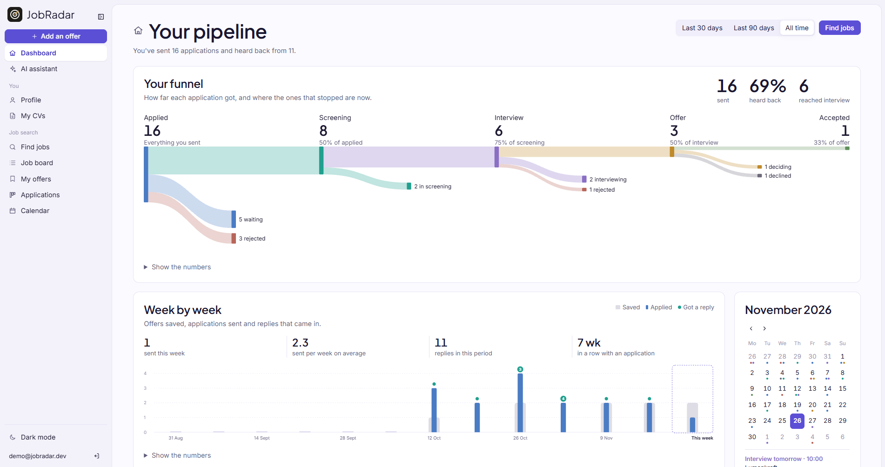

## Features

- **Profile and CVs:** desired position, level, cities, employment types and skills. Upload a PDF CV and the AI reads it, fills your profile (you pick the fields) and writes a career snapshot.
- **Find jobs:** search job boards through Tavily and Google Jobs (JSearch) with a form prefilled from your profile. Results from other cities or far from your level are hidden, not lost. Nothing is stored until you save a result.
- **Job board:** offers posted on the site by admins (CSV/JSON import), with filters.
- **My offers:** everything you track, plus offers you add yourself. Paste a posting and the AI fills the form.
- **AI analysis:** a 0-100 match score from a fixed rubric (the model reads, code scores), with matched and missing skills, reasons and red flags, plus a structured summary of the posting.
- **Applications:** a drag-and-drop board with eight statuses, notes, interview dates, the CV you sent and the full status history, and a calendar.
- **Dashboard:** your funnel, week by week activity, stale applications and replies.
- **AI assistant:** a chat that reads your profile, applications and calendar, searches for jobs and analyses offers. It changes something only after you confirm.
- **Admin panel:** users and roles, offer import, posted offers, statistics and global search source switches.
- **Light and dark theme.**

## Screenshots

<table>
  <tr>
    <td width="50%">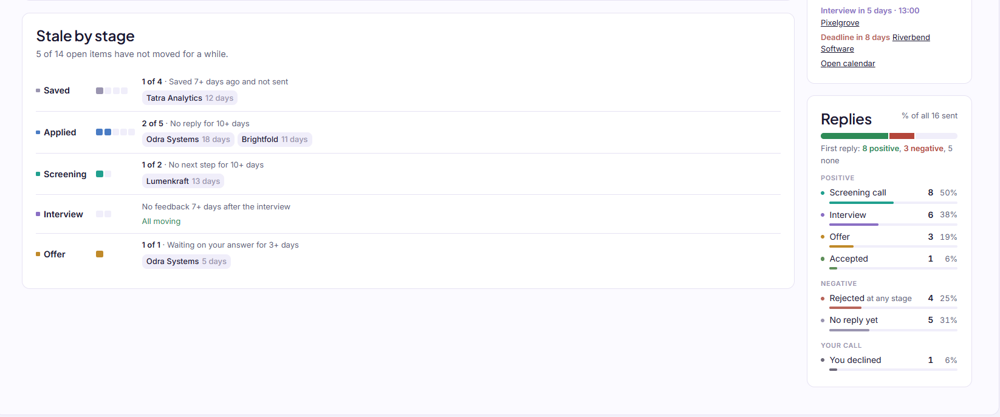 <b>Dashboard:</b> stale applications and replies</td>
    <td width="50%">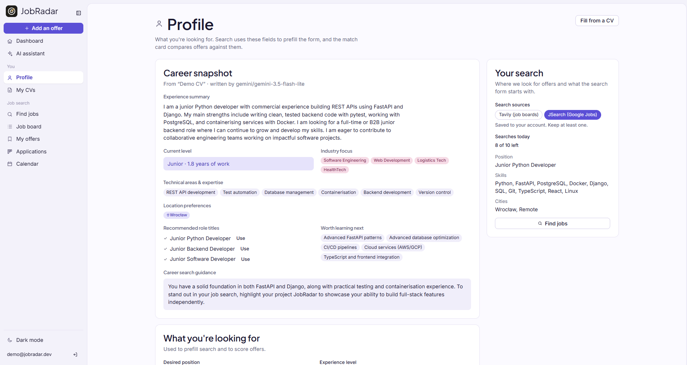 <b>Profile:</b> career snapshot written from the CV</td>
  </tr>
  <tr>
    <td>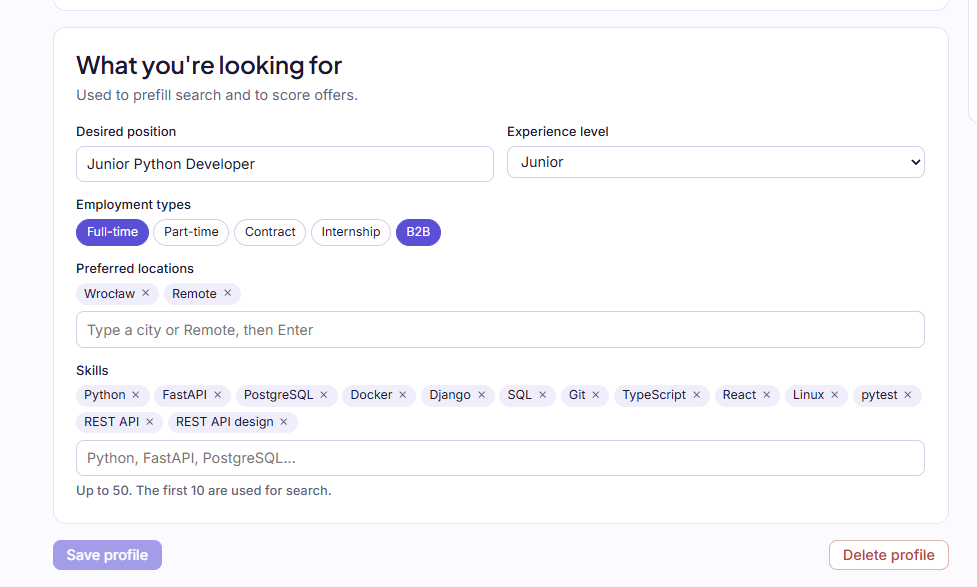 <b>Profile:</b> what you're looking for</td>
    <td>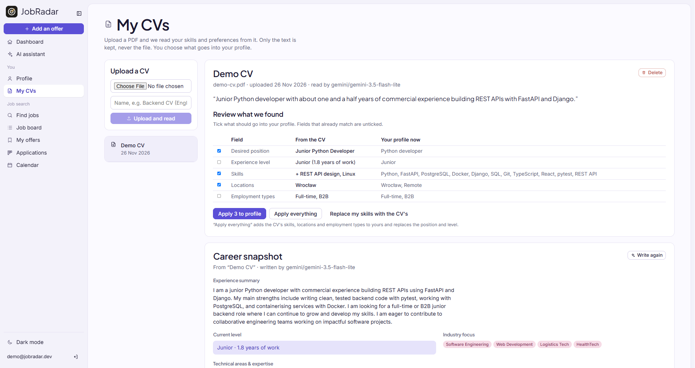 <b>My CVs:</b> pick what goes into your profile</td>
  </tr>
  <tr>
    <td>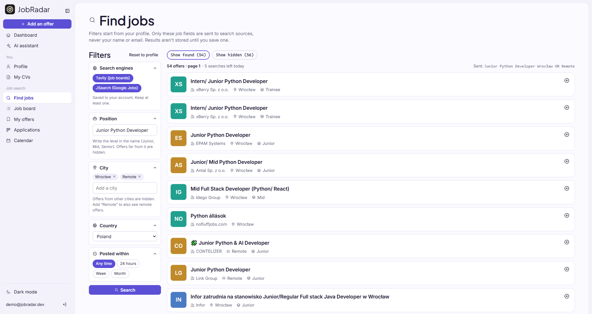 <b>Find jobs:</b> live search on job boards</td>
    <td>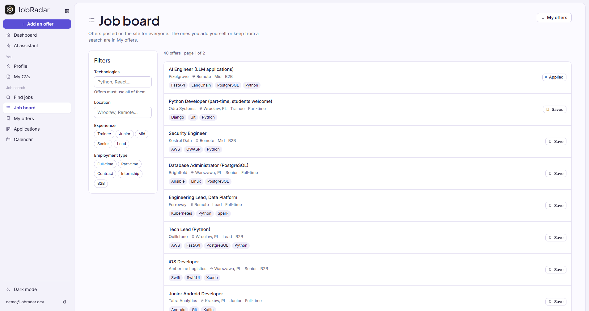 <b>Job board:</b> offers posted on the site</td>
  </tr>
  <tr>
    <td>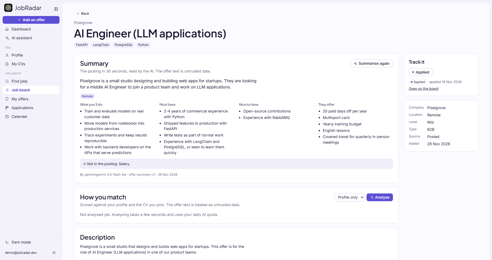 <b>Offer:</b> AI summary of the posting</td>
    <td>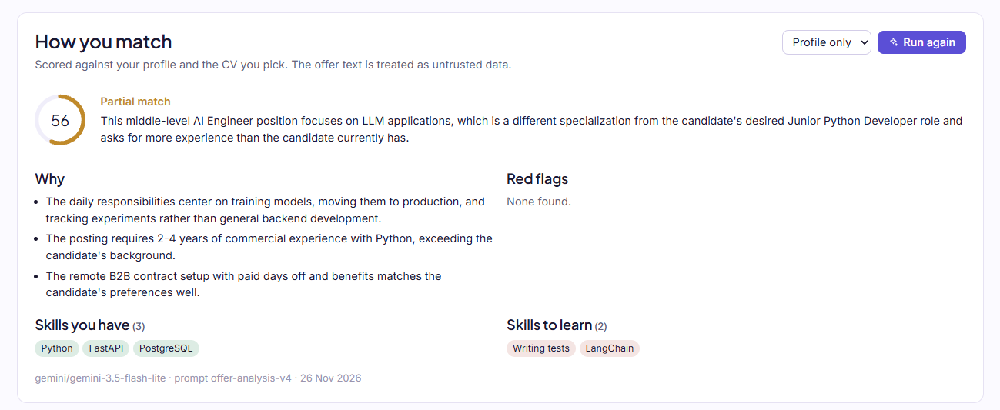 <b>Offer:</b> how you match, 0-100</td>
  </tr>
  <tr>
    <td>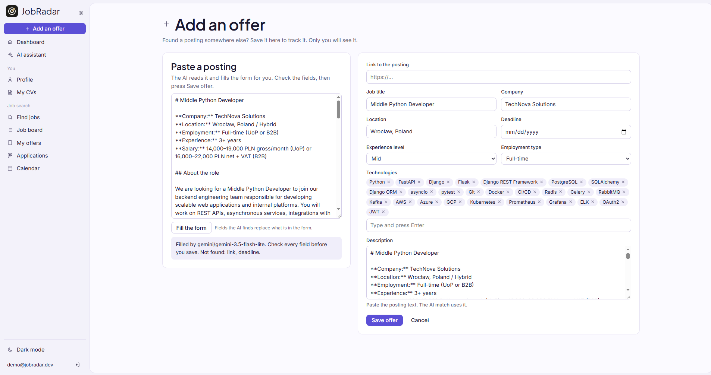 <b>Add an offer:</b> paste a posting, the AI fills the form</td>
    <td>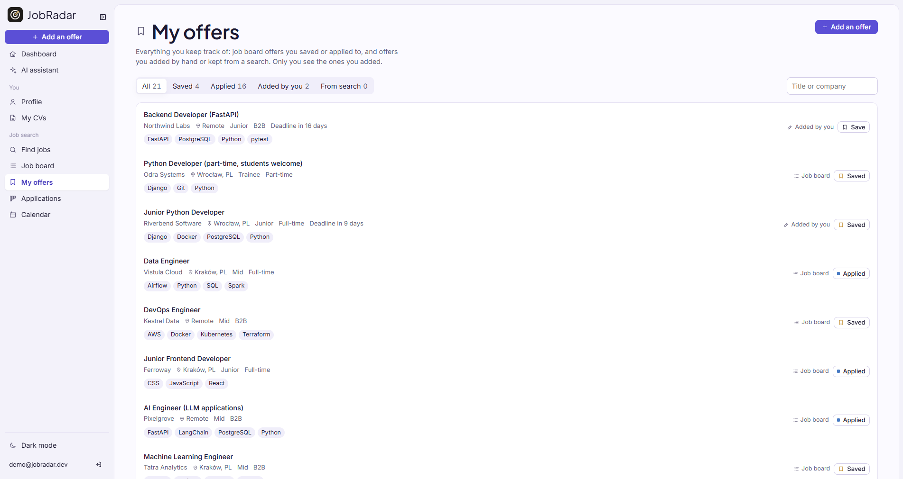 <b>My offers:</b> everything you track</td>
  </tr>
  <tr>
    <td>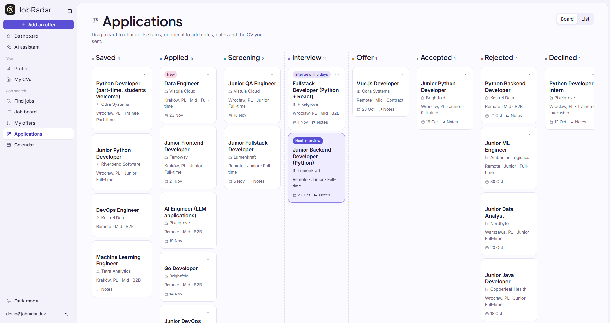 <b>Applications:</b> drag a card to change its status</td>
    <td>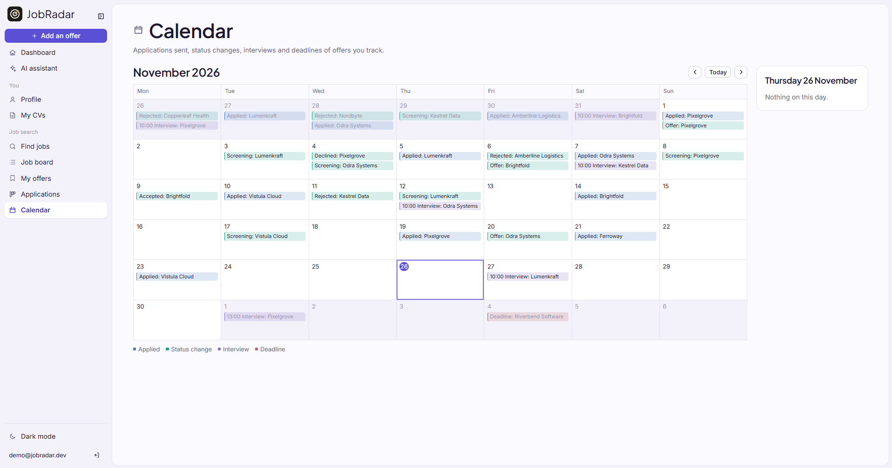 <b>Calendar:</b> applications, interviews and deadlines</td>
  </tr>
  <tr>
    <td>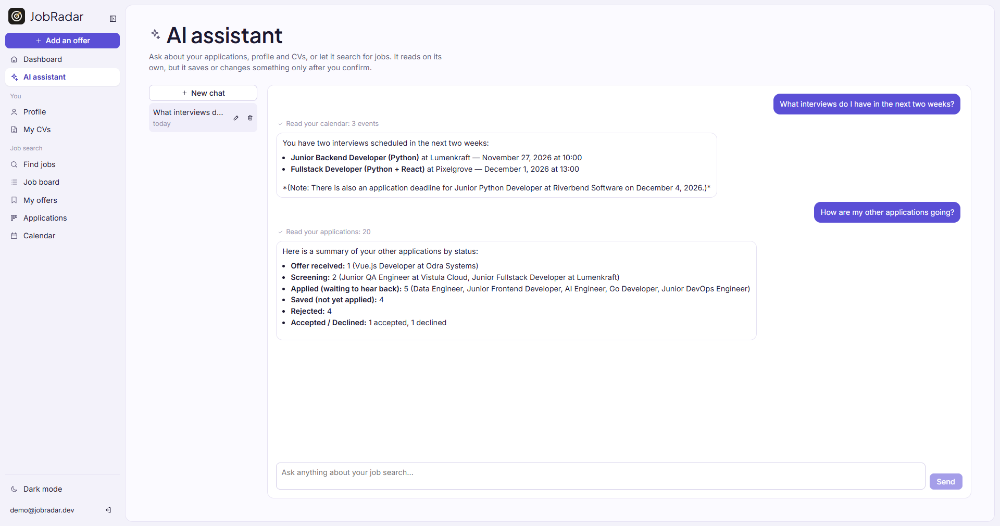 <b>AI assistant:</b> answers from your own data</td>
    <td>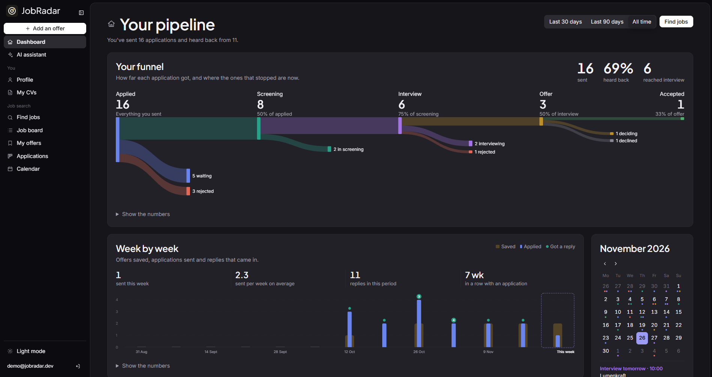 <b>Dark theme</b></td>
  </tr>
</table>

> **About the data in the screenshots.** Everything shown belongs to a synthetic demo account created with `just seed-demo`: the applications, their history and the companies on the Job board are made up. The CV is a synthetic one written for the demo (`backend/seed/demo-cv.pdf`, "Alex Nowak"); it describes no real person. Only the results on **Find jobs** are real, live results from the search sources. The AI features in the screenshots ran on Gemini (`gemini-3.5-flash-lite`).

## Tech stack

- **Backend:** Python 3.12, FastAPI, SQLAlchemy 2, Alembic, Pydantic 2, PostgreSQL 17
- **Frontend:** React 19, TypeScript, Vite 7, React Router 7, plain CSS, hand-drawn SVG charts
- **AI:** one provider interface for Ollama (local models), OpenAI, Gemini and Anthropic
- **Search:** Tavily Search API and JSearch (OpenWeb Ninja)
- **Quality:** Ruff, mypy (strict), pytest, Vitest, ESLint, Prettier, pre-commit, GitHub Actions

## Quick start

You need Docker (for Postgres), [uv](https://docs.astral.sh/uv/), [just](https://just.systems/) 1.42+ and Node.js 22. From the repository root:

1. Copy `.env.example` to `.env`, then `docker compose up -d postgres` to start the database
2. Copy `backend/.env.example` to `backend/.env` and fill it in (with `SEARCH_SOURCES='["fake"]'` and `AI_PROVIDER=fake` it runs without any API key)
3. `cd backend; uv run alembic upgrade head; cd ..` to create the tables
4. `just seed` to load the demo job offers (safe to run again)
5. Optional: `just seed-demo` for the demo account `demo@jobradar.dev` / `demo12345` with two months of history
6. `cd frontend; npm install; cd ..`
7. `just run` to start both servers: the app at http://localhost:5173 and the API docs at http://127.0.0.1:8000/docs

`just check` runs the backend checks (Ruff, mypy, pytest) and `just frontend-check` the frontend ones.

## Documentation

- [Wiki](https://github.com/yevsky/job-radar-ai/wiki): setup, architecture, every feature, the API reference, testing and the development workflow
- [docs/database.md](docs/database.md): the database schema
- [docs/git_conventions.md](docs/git_conventions.md): branches and commit messages
