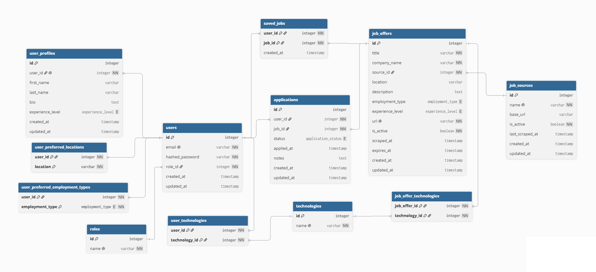

# Database Schema

This document describes the relational database schema for the job offer discovery and analysis application. It covers the core functionality: user management, user profiles and preferences, job offer storage, technology tagging, saved jobs and application tracking.

Job offers are **not bulk-scraped** from job boards. They reach the application in three ways: a Tavily web search built from the user's profile, the "Send to JobRadar" browser button, or a manual import of a link. Only the offer's basic facts (link, title, company, location, deadline and source) are stored. The full offer text is not stored; it is fetched only when an offer is analysed.

> **Note:** Tables related to the AI assistant module (e.g. query history, match results) and to search logging are **not included yet**. They will be added together with the features that use them, and this document will be updated at that point.

## Overview

The schema is organized around five functional areas:

1. **Access control** — users, roles, and user profiles
2. **User preferences** — skills and standing filter preferences used for search and matching
3. **Job offer data** — job offers and technologies
4. **User activity** — saved jobs and applications
5. *(Planned)* **AI assistant module and search logging** — to be added later

## Enums

### `employment_type`
Describes the type of employment contract associated with a job offer or preferred by a user.

| Value | Description |
|---|---|
| `full_time` | Full-time employment |
| `part_time` | Part-time employment |
| `contract` | Fixed-term contract |
| `internship` | Internship position |
| `b2b` | Business-to-business contract (common in the Polish IT market) |

### `experience_level`
Describes the seniority level of a job offer or a user's declared experience.

| Value | Description |
|---|---|
| `trainee` | Entry-level / trainee or intern |
| `junior` | Junior |
| `middle` | Mid-level |
| `senior` | Senior |
| `lead` | Lead / management-adjacent |

### `source_kind`
Describes how a job offer reached the application.

| Value | Description |
|---|---|
| `search` | Found by a Tavily web search built from the user's profile |
| `browser` | Sent from the "Send to JobRadar" browser button |
| `manual` | Added by hand: a pasted link or an admin file import |

### `application_status`
Tracks the state of a user's application to a given job offer.

| Value | Description |
|---|---|
| `applied` | Application submitted |
| `interview` | In the interview process |
| `rejected` | Application rejected |
| `accepted` | Offer accepted |

## Tables

### `roles`
Defines system-level user roles (e.g. `admin`, `user`).

| Column | Type | Notes |
|---|---|---|
| `id` | integer | Primary key |
| `name` | varchar | Unique, not null |

### `users`
Application user accounts, including authentication data.

| Column | Type | Notes |
|---|---|---|
| `id` | integer | Primary key |
| `email` | varchar | Unique, not null |
| `hashed_password` | varchar | Not null |
| `role_id` | integer | FK → `roles.id`, not null |
| `created_at` | timestamp | |
| `updated_at` | timestamp | |

### `user_profiles`
Extended profile information for a user, one-to-one with `users`.

| Column | Type | Notes |
|---|---|---|
| `id` | integer | Primary key |
| `user_id` | integer | FK → `users.id`, unique, not null |
| `first_name` | varchar | |
| `last_name` | varchar | |
| `bio` | text | |
| `experience_level` | experience_level | |
| `desired_position` | varchar | The role the user is looking for (e.g. "backend developer"), used to build search queries |
| `created_at` | timestamp | |
| `updated_at` | timestamp | |

### `user_preferred_locations`
Standing location preferences used for search and filtering. A user may have multiple preferred locations. `Remote` is a valid value, which is how a user expresses a preference for remote work.

| Column | Type | Notes |
|---|---|---|
| `user_id` | integer | FK → `users.id`, part of composite PK |
| `location` | varchar | Free-text, part of composite PK |

### `user_preferred_employment_types`
Standing employment type preferences used for search and filtering. A user may prefer more than one employment type.

| Column | Type | Notes |
|---|---|---|
| `user_id` | integer | FK → `users.id`, part of composite PK |
| `employment_type` | employment_type | Part of composite PK |

### `technologies`
A flat vocabulary of technologies/skills (e.g. "React", "Python", "Docker") referenced by both job offers and user profiles. New entries are created automatically when a user or an offer mentions a technology that is not in the table yet.

| Column | Type | Notes |
|---|---|---|
| `id` | integer | Primary key |
| `name` | varchar | Unique, not null |

### `user_technologies`
Many-to-many mapping between users and the technologies they know, used for search and matching.

| Column | Type | Notes |
|---|---|---|
| `user_id` | integer | FK → `users.id`, part of composite PK |
| `technology_id` | integer | FK → `technologies.id`, part of composite PK |

### `job_offers`
Core table storing the basic facts of individual job postings. The full offer text is intentionally not stored.

| Column | Type | Notes |
|---|---|---|
| `id` | integer | Primary key |
| `title` | varchar | Not null |
| `company_name` | varchar | Not null |
| `source` | source_kind | Not null — how the offer reached the application |
| `location` | varchar | Free-text |
| `employment_type` | employment_type | |
| `experience_level` | experience_level | |
| `url` | varchar | Not null, unique — the link to the original offer, used as the dedup key |
| `is_active` | boolean | Not null, default `true` — marks whether the offer is still live |
| `deadline` | timestamp | Application deadline, if known |
| `last_seen_at` | timestamp | When a search or import last found this offer |
| `created_at` | timestamp | |
| `updated_at` | timestamp | |

Indexed on `location`, `employment_type`, `experience_level`, and `is_active` to support filtering.

### `job_offer_technologies`
Many-to-many mapping between job offers and the technologies they require.

| Column | Type | Notes |
|---|---|---|
| `job_offer_id` | integer | FK → `job_offers.id`, part of composite PK |
| `technology_id` | integer | FK → `technologies.id`, part of composite PK |

### `saved_jobs`
Tracks which job offers a user has bookmarked for later. Saving is independent of applying: an offer can be saved, applied to, or both.

| Column | Type | Notes |
|---|---|---|
| `user_id` | integer | FK → `users.id`, part of composite PK |
| `job_offer_id` | integer | FK → `job_offers.id`, part of composite PK |
| `created_at` | timestamp | |

### `applications`
Tracks a user's application to a specific job offer, including status and notes.

| Column | Type | Notes |
|---|---|---|
| `id` | integer | Primary key |
| `user_id` | integer | FK → `users.id`, not null |
| `job_offer_id` | integer | FK → `job_offers.id`, not null |
| `status` | application_status | Not null, default `applied` |
| `applied_at` | timestamp | |
| `notes` | text | |
| `created_at` | timestamp | |
| `updated_at` | timestamp | |

Unique on (`user_id`, `job_offer_id`): a user has at most one application per offer.

## Relationships Summary

- `users.role_id` → `roles.id`
- `user_profiles.user_id` → `users.id` (1:1)
- `user_preferred_locations.user_id` → `users.id` (1:N)
- `user_preferred_employment_types.user_id` → `users.id` (1:N)
- `user_technologies` links `users` ↔ `technologies` (M:N)
- `job_offer_technologies` links `job_offers` ↔ `technologies` (M:N)
- `saved_jobs` links `users` ↔ `job_offers` (M:N)
- `applications` links `users` ↔ `job_offers` (1 application row per user–offer pair, extended with status/notes)

Deleting a user deletes their profile, preferences, skills links, saved jobs and applications. Deleting a user never deletes rows in `technologies`.

## Design Notes

- **No bulk scraping.** Offers are found through Tavily search or sent by the user (browser button, manual import), and only their basic facts are stored. This avoids copying job boards' content, which could conflict with their terms of use and database rights. The offer page is fetched only when the offer is analysed.
- **No `job_sources` table.** There are only three fixed ways an offer can arrive, so the `source_kind` enum on `job_offers` replaces a lookup table. The job board an offer comes from can be read from its `url` domain.
- **Deduplication of offers** relies on the `url` uniqueness constraint on `job_offers`. When a search or import finds an existing URL again, the row is updated (`last_seen_at`, `is_active`) rather than duplicated.
- **Saved jobs and applications are separate.** Saving is a bookmark with no status; an application has a life cycle. Keeping them in two tables means each fact is stored in one place, and `application_status` has no `saved` value.
- **Location and preference matching** use free-text fields rather than a normalized `locations` table. Location strings vary significantly between job boards (e.g. "Warszawa" vs "Warsaw, PL" vs "Remote/Warsaw"), so normalization/geocoding is left as a possible future improvement.
- **`technologies` and `roles`** are treated as lookup tables. `created_at` was intentionally omitted from `technologies` since no current feature depends on knowing when a technology entry was created.

## Planned Additions (Future Work)

The following will be added together with the features that need them:

- **AI assistant module:** a table storing AI query history (per user, per job offer: query type, prompt version, the anonymised context sent to the model and the validated response), and a table storing match results per user and offer (match label, score, "why it fits" and "watch out").
- **Search logging:** a table of Tavily search runs, if needed for per-user search limits, caching and usage statistics.
- Possible extensions to `job_offer_technologies` (e.g. required vs. nice-to-have flags) if AI-driven matching requires finer-grained weighting.